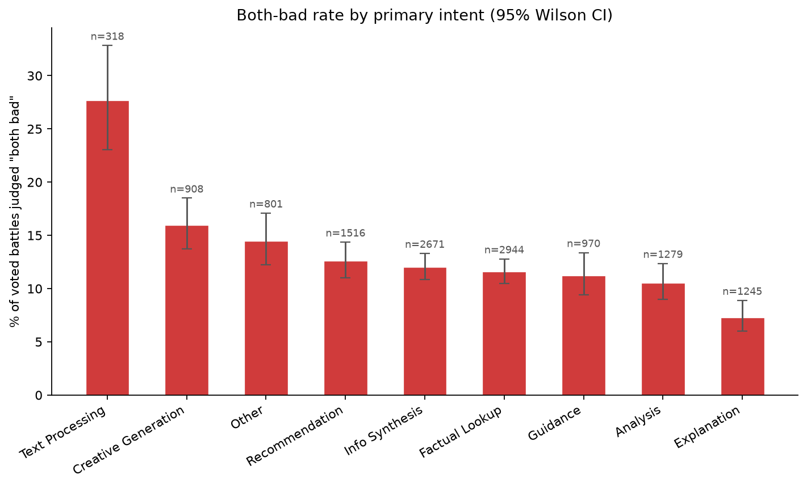

# Both-Bad Rate: A Churn/Catastrophic-Failure Signal

## Methodology

This is a distinct failure signal from the decisive win/loss analysis in `loss_anatomy_summary.md`: instead of asking "which response won," it asks "how often did the judge decide *neither* response was acceptable."

**Step 0 finding, confirmed before building anything:** the raw `winner` field in this dataset has a genuine, separately-labeled **"both bad"** category, distinct from an ordinary "both good" tie:

| raw `winner` value | count | meaning |
|---|---|---|
| `model_a` | 4,255 | model_a wins (decisive) |
| `model_b` | 4,358 | model_b wins (decisive) |
| `tie` | 2,502 | tie -- both judged acceptable |
| `tie (bothbad)` | 1,537 | tie -- both judged bad (**the signal this report measures**) |
| *(missing / NaN)* | 11,417 | no vote occurred |
| **total** | **24,069** | |

This is case (a) from the brief: a real label exists, so the both-bad rate is computed directly from it -- **no proxy was built or needed.** Note that the existing pipeline (`intent_complexity_analysis_v2.py`'s `TIE_WINNERS = ("tie", "tie (bothbad)")`) collapses both tie types into one `is_tie` boolean for the citation/length analysis -- the right call for that analysis, since both are "not decisive," but it throws away exactly the distinction this report needs. This script does not touch that collapsing logic; it reads the raw `winner` string column (preserved as-is in `outputs/final_analysis_derived.csv`) and draws its own, separate line.

**Denominator, stated explicitly.** The headline rate `pct_both_bad_of_voted` is both-bad count divided by *voted* battles only (`decisive + tie + tie (bothbad)`), since "both bad" is a judgment that can only be made when a vote occurred -- the 11,417 no-vote conversations carry no information either way. A secondary column, `pct_both_bad_of_all`, is also reported against the full row count (including no-vote rows) for readers who want that denominator instead; the two are not interchangeable and the chart below uses `pct_both_bad_of_voted` only.

**Interval method, stated explicitly.** No proportion confidence interval is already established elsewhere in this project -- the rest of the project only ever bootstraps Bradley-Terry coefficients, never a raw proportion. The **Wilson score interval** is used here instead of a normal (Wald) approximation because it stays well-calibrated at small n and at rates far from 50%, both of which apply to several cells below (e.g. Text Processing has only 318 voted battles). This is a new addition to the project's statistical toolkit, not a silent substitution for an existing method.

**Scope note.** Unlike `loss_anatomy.py`, this analysis covers every voted battle, not just decisive ones -- ties are the subject here, not an excluded category.

## Findings: both-bad rate by primary intent

| primary_intent | n_voted | n_both_bad | % both bad (of voted) | 95% Wilson CI | % both bad (of all, incl. no-vote) |
|---|---|---|---|---|---|
| Text Processing | 318 | 88 | **27.67%** | [23.04%, 32.83%] | 11.70% |
| Creative Generation | 908 | 145 | **15.97%** | [13.73%, 18.49%] | 6.34% |
| Other | 801 | 116 | **14.48%** | [12.21%, 17.09%] | 5.88% |
| Recommendation | 1,516 | 191 | **12.60%** | [11.02%, 14.36%] | 7.37% |
| Info Synthesis | 2,671 | 321 | **12.02%** | [10.84%, 13.31%] | 7.17% |
| Factual Lookup | 2,944 | 341 | **11.58%** | [10.48%, 12.79%] | 7.33% |
| Guidance | 970 | 109 | **11.24%** | [9.40%, 13.38%] | 4.97% |
| Analysis | 1,279 | 135 | **10.56%** | [8.99%, 12.36%] | 5.13% |
| Explanation | 1,245 | 91 | **7.31%** | [5.99%, 8.89%] | 3.63% |

*Bars show the % of voted battles in each intent judged "both bad," with 95% Wilson CIs; `n` above each bar is the number of voted battles for that intent.*

## Findings: both-bad rate by conversation type

| conversation_type | n_voted | n_both_bad | % both bad (of voted) | 95% Wilson CI |
|---|---|---|---|---|
| multi_turn | 2,598 | 387 | **14.90%** | [13.58%, 16.32%] |
| single_turn | 10,054 | 1,150 | **11.44%** | [10.83%, 12.08%] |

## Findings: both-bad rate by citation presence (testing the zero-citation hypothesis)

**Motivation.** The Step-3 sanity check above eyeballed 3 example "both bad" battles; 2 of the 3 had zero citations on at least one side. This section tests whether that holds up across the full voted set, or whether it was an artifact of 3 small examples. Battles are split into two groups using `citations_a`/`citations_b` exactly as already computed in `outputs/final_analysis_derived.csv` (the fixed per-turn-deduped measure used everywhere else in this project -- nothing recomputed):

- `at_least_one_zero_citation`: `citations_a == 0 OR citations_b == 0`
- `both_have_citations`: `citations_a > 0 AND citations_b > 0`

**Overall (pooled across all intents):**

| citation_group | n_voted | n_both_bad | % both bad | 95% Wilson CI |
|---|---|---|---|---|
| at_least_one_zero_citation | 4,459 | 731 | **16.39%** | [15.34%, 17.51%] |
| both_have_citations | 8,193 | 806 | **9.84%** | [9.21%, 10.50%] |

**The hypothesis holds up at the overall level.** The two 95% CIs do not overlap: battles with at least one zero-citation side have a **higher** both-bad rate than battles where both sides cited something.

**Per-intent breakdown.** Cells with fewer than 30 voted battles are flagged rather than reported as a rate (per-intent sample sizes split two ways get thin quickly):

| primary_intent | citation_group | n_voted | % both bad | 95% Wilson CI |
|---|---|---|---|---|
| Analysis | at_least_one_zero_citation | 454 | 14.32% | [11.39%, 17.84%] |
| Analysis | both_have_citations | 825 | 8.48% | [6.77%, 10.58%] |
| Creative Generation | at_least_one_zero_citation | 626 | 17.73% | [14.94%, 20.92%] |
| Creative Generation | both_have_citations | 282 | 12.06% | [8.76%, 16.38%] |
| Explanation | at_least_one_zero_citation | 409 | 11.49% | [8.75%, 14.95%] |
| Explanation | both_have_citations | 836 | 5.26% | [3.94%, 6.99%] |
| Factual Lookup | at_least_one_zero_citation | 728 | 16.35% | [13.84%, 19.21%] |
| Factual Lookup | both_have_citations | 2,216 | 10.02% | [8.84%, 11.34%] |
| Guidance | at_least_one_zero_citation | 397 | 14.86% | [11.70%, 18.70%] |
| Guidance | both_have_citations | 573 | 8.73% | [6.68%, 11.32%] |
| Info Synthesis | at_least_one_zero_citation | 677 | 17.13% | [14.48%, 20.16%] |
| Info Synthesis | both_have_citations | 1,994 | 10.28% | [9.02%, 11.69%] |
| Other | at_least_one_zero_citation | 492 | 16.26% | [13.26%, 19.78%] |
| Other | both_have_citations | 309 | 11.65% | [8.54%, 15.71%] |
| Recommendation | at_least_one_zero_citation | 438 | 14.84% | [11.82%, 18.47%] |
| Recommendation | both_have_citations | 1,078 | 11.69% | [9.91%, 13.74%] |
| Text Processing | at_least_one_zero_citation | 238 | 28.99% | [23.60%, 35.05%] |
| Text Processing | both_have_citations | 80 | 23.75% | [15.76%, 34.14%] |

0 of 18 (intent, citation_group) cells were too thin (< 30 voted battles) to report a rate for.

## Plain-language summary

**Highest both-bad rate:** `Text Processing` at **27.67%** of voted battles (95% CI [23.04%, 32.83%], n=318) -- this is the intent category where judges most often found neither response acceptable.
**Lowest both-bad rate:** `Explanation` at **7.31%** (95% CI [5.99%, 8.89%], n=1,245).

**Multi-turn vs single-turn:** multi-turn conversations show a **higher** both-bad rate (14.90% vs 11.44% for single-turn). The 95% CIs do not overlap, a real difference -- read the CI columns above rather than the point estimates alone.

**Zero-citation hypothesis:** held up -- battles with at least one zero-citation side have a real, CI-confirmed **higher** both-bad rate than battles where both sides cited something.

## Caveats

1. **"Both bad" is the judge's call, not an independently verified content assessment.** This report takes the `tie (bothbad)` label at face value, consistent with how `is_decisive`/`is_tie` are already treated elsewhere in this project -- it is not re-derived from response content.
2. **No-vote conversations (11,417 of 24,069) are excluded from the headline rate.** They cannot be either confirmed or ruled out as "both bad" since no judgment was recorded; `pct_both_bad_of_all` is reported for transparency but treats every no-vote row as a non-both-bad, which is an assumption, not a fact.
3. **Small-n cells.** Several (intent, conversation_type) cells have limited voted battles; the Wilson CI widens accordingly and is the number to read, not the point estimate alone.
4. **No multiple-comparisons correction** is applied across the 9 intent categories or the 2 conversation-type categories reported here, consistent with how this was flagged (and later BH-corrected) for the citation/tier analyses elsewhere in this project -- it has not been corrected here.
5. **This is a rate, not a cause.** A high both-bad rate for an intent says nothing about *why* -- it could reflect harder queries, worse model coverage for that intent, or judge strictness; this report does not attempt to disambiguate those.
6. **Citation presence and both-bad are both observational.** Even where the zero-citation split shows a real CI-confirmed gap, this does not establish that missing citations *causes* a both-bad judgment -- queries where no good source exists may independently drive both zero citations and a bad judgment on both sides. No causal claim is made here.

