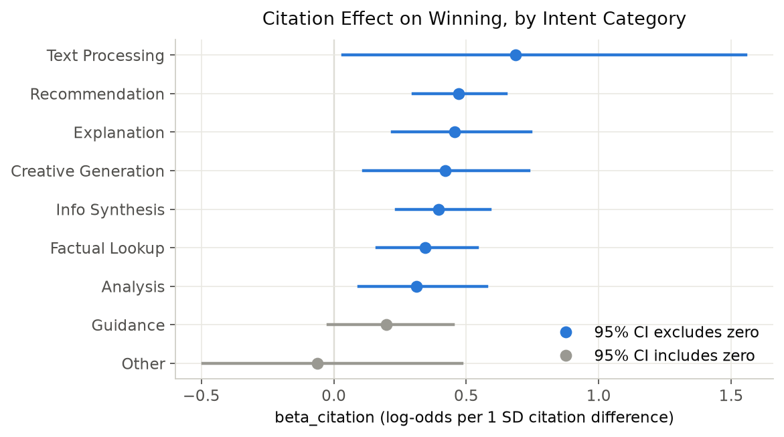
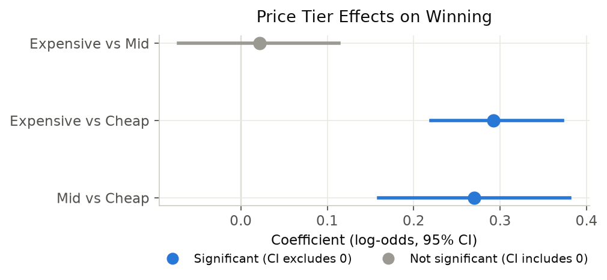
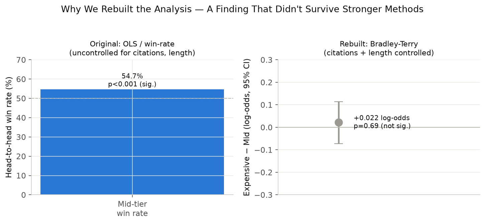
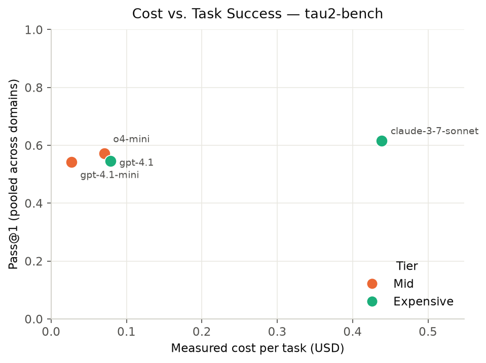
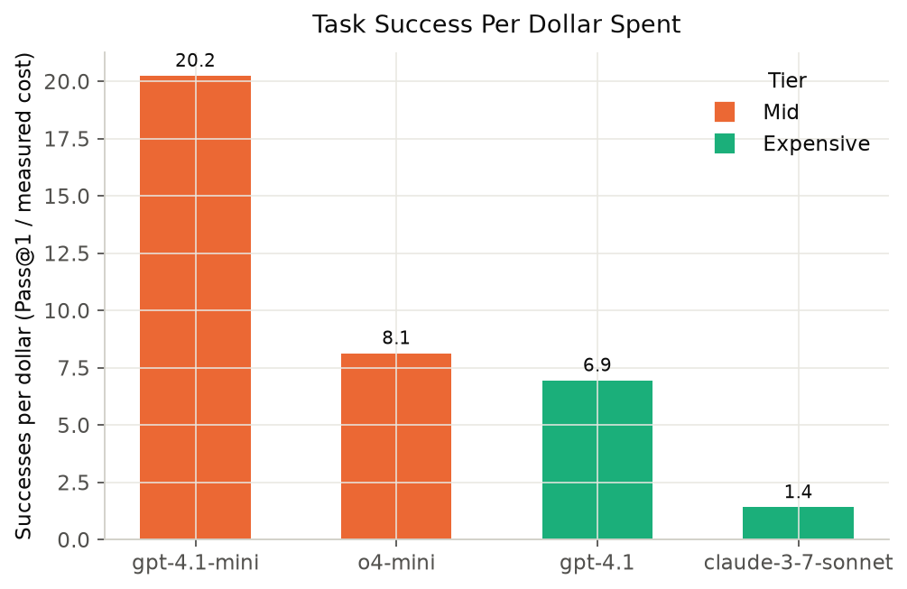
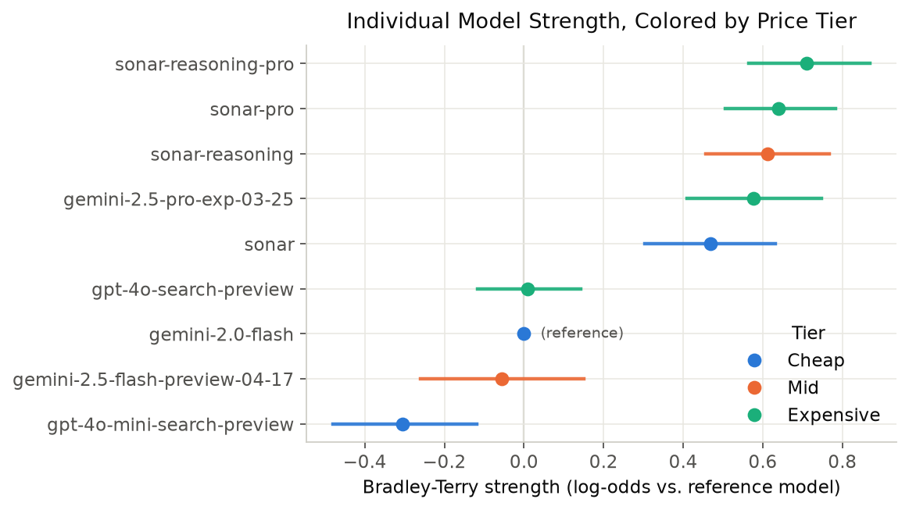
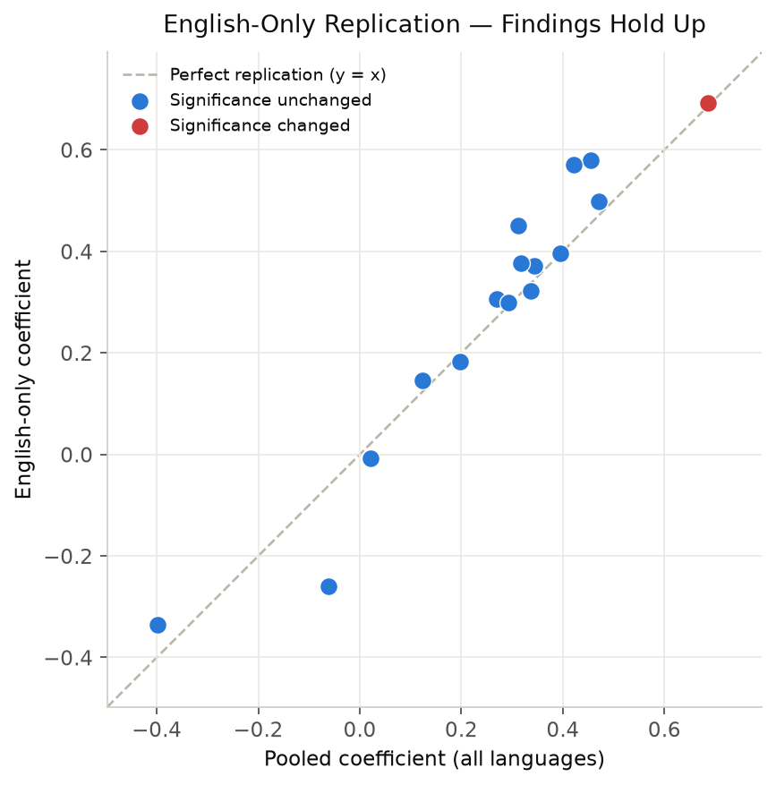
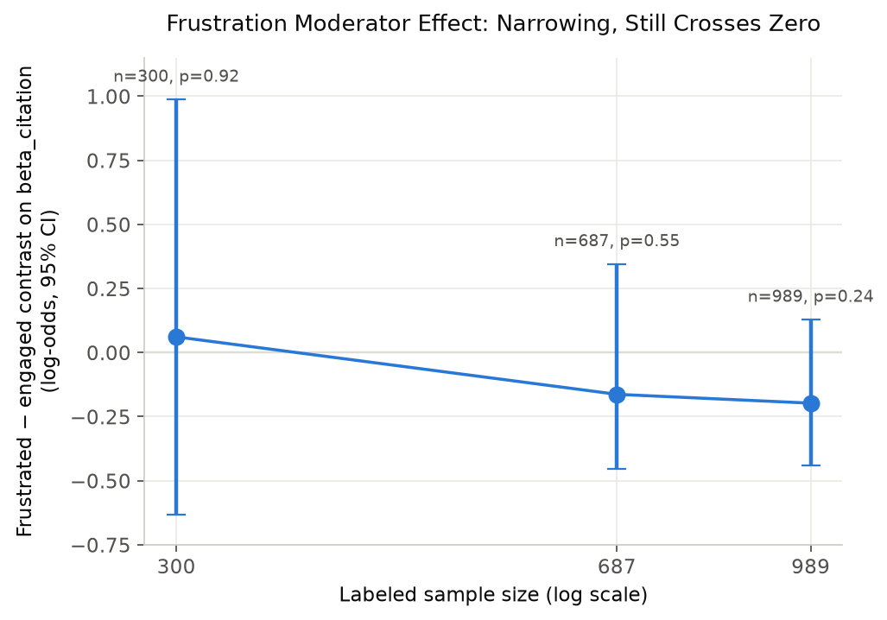

# Bradley-Terry Rebuild of the Core Search Arena Analysis

## Methodology

Preference outcomes in this dataset are pairwise, so the effect of a covariate on *winning* is naturally modelled on the pairwise comparison itself rather than on a residualized per-response score. For each battle between `model_a` and `model_b`, with `y = 1` when `model_a` is the decisive winner:

```
P(a beats b) = sigmoid( theta_a - theta_b + beta_cit * (cit_a - cit_b)
                                          + beta_len * (len_a - len_b) )
```

`theta` are latent per-player strengths and `beta` are covariate coefficients on the *difference* in observed covariates. Because every term is a difference, the model is exactly a no-intercept logistic regression on differenced features, fitted by maximum likelihood (L-BFGS-B, analytic gradient). One player strength is fixed at zero for identifiability.

- **Data:** 24,069 conversations; **8,613 decisive battles** after excluding ties and unvoted conversations.
- **Citation measure:** the fixed per-turn aggregation (visible citation markers deduped *within* each assistant turn, then summed across turns), carried over unchanged from `intent_complexity_analysis_v2.py`.
- **Covariate scaling:** coefficients are per 1 SD of the covariate difference (1 SD = 6.126 citations; 1 SD = 3,223 characters). Scaling constants are computed once on the full decisive set, so coefficients are on identical units and are comparable across intent categories.
- **Uncertainty:** 1,000 bootstrap replications resampling at the **conversation level** (each row is one conversation). Reported intervals are 2.5/97.5 percentile CIs; the bootstrap p-value is twice the smaller tail mass either side of zero. A coefficient is called significant when its 95% CI excludes zero.
- **Reproducibility:** fixed seed `20260930`. No API calls; runs locally against already-processed data.

*Provenance note:* this is an implementation of the standard Bradley-Terry-with-covariates specification and a conversation-level bootstrap, which is the established approach for arena-style pairwise preference data. It was written to that standard specification; the internal details of the individual reference notebooks (Miroyan et al.'s `preference_analysis.ipynb`, the Maximal Lotteries paper, the News Source Citing Patterns paper) were not available offline and so were not inspected. Any deliberate deviation in those papers — a different tie treatment, covariate transform, or bootstrap unit — would not be reflected here.

Coefficients are on the **log-odds** scale: a coefficient of 0.30 means a one-SD advantage in that covariate multiplies the odds of winning by `exp(0.30)` = 1.35.

## Results: citation effect by intent category

Each row is a separate BT fit on that category's decisive battles, with per-model strengths absorbing model identity and response length included as a simultaneous covariate.


*Citations predict winning in most intent categories (blue, CI excludes zero); only Guidance and Other don't clear that bar.*

| primary_intent | n | beta_citation | 95% CI | boot p | significant | beta_length | length sig |
|---|---|---|---|---|---|---|---|
| Factual Lookup | 1974 | +0.3445 | [+0.163, +0.543] | 0.0000 | **yes** | +0.4306 | yes |
| Text Processing *(low power)* | 184 | +0.6861 | [+0.033, +1.556] | 0.0380 | **yes** | +1.2970 | yes |
| Other | 451 | -0.0623 | [-0.495, +0.485] | 0.7980 | no | +0.4512 | no |
| Explanation | 901 | +0.4549 | [+0.220, +0.744] | 0.0020 | **yes** | +0.4837 | yes |
| Recommendation | 1026 | +0.4706 | [+0.299, +0.652] | 0.0000 | **yes** | +0.3981 | yes |
| Guidance | 680 | +0.1975 | [-0.023, +0.451] | 0.0840 | no | +0.4617 | yes |
| Info Synthesis | 1892 | +0.3956 | [+0.236, +0.590] | 0.0000 | **yes** | +0.8389 | yes |
| Analysis | 901 | +0.3116 | [+0.094, +0.577] | 0.0000 | **yes** | +0.8982 | yes |
| Creative Generation | 604 | +0.4210 | [+0.112, +0.736] | 0.0060 | **yes** | +0.1922 | yes |

**7 of 9** fitted categories show a citation coefficient whose 95% CI excludes zero.

## Results: cost tier

> **Identification constraint.** Cost tier is a deterministic function of model identity, so tier indicators and per-model strengths are perfectly collinear and cannot both enter one model — the tier effect would be unidentified. Tier effects are therefore estimated with **tier as the player identity** (cheap = reference, strength 0), with citation and length differences controlled in the same fit. This answers "does tier predict winning", but tier effects are *not* additionally controlled for within-tier model identity. This is a property of the design, not a modelling choice that could be avoided.

| term | coefficient | 95% CI | boot p | significant |
|---|---|---|---|---|
| tier: mid vs cheap | +0.2702 | [+0.160, +0.381] | 0.0000 | **yes** |
| tier: expensive vs cheap | +0.2919 | [+0.220, +0.372] | 0.0000 | **yes** |
| beta_citation (per 1 SD) | +0.5022 | [+0.414, +0.582] | 0.0000 | **yes** |
| beta_length (per 1 SD) | +0.7248 | [+0.562, +0.872] | 0.0000 | **yes** |


*Mid and Expensive both clearly beat Cheap (blue); Expensive does not clearly beat Mid (gray, CI crosses zero).*

**mid vs expensive contrast (expensive − mid) = +0.0217** log-odds, 95% CI [-0.072, +0.114], p = 0.69 — **NOT significant**. The point estimate nominally favours expensive, but the interval comfortably spans zero: once citations and length are controlled, **mid and expensive are statistically indistinguishable**. The contrast is computed on the bootstrap draws, which preserves the correlation between the two tier coefficients.

The same holds per category: the mid-vs-expensive contrast is non-significant in **8 of 9** intent categories. The single exception (Creative Generation, contrast +0.353, p = 0.040) favours *expensive*, and with ten uncorrected tests one result at p ≈ 0.04 is what chance alone predicts — **confirmed**: it does not survive Benjamini-Hochberg correction (BH-adjusted p = 0.063; see "Multiple-Comparisons Correction" below).

Per-category tier fits are in `bradley_terry_cost_tier.csv`.

## OLS residualization vs Bradley-Terry

The two methods answer slightly different questions and are on different scales, so they are compared on **direction** and **significance**, not on coefficient magnitude. The OLS column is the model-and-length-controlled partial correlation from `final_analysis.py`; the BT column is the citation coefficient from this rebuild.

| finding | OLS estimate | OLS sig | BT estimate | BT sig | verdict |
|---|---|---|---|---|---|
| citation:Factual Lookup | +0.0554 | yes | +0.3445 | yes | agree |
| citation:Text Processing | +0.0800 | no | +0.6861 | yes | **SIGNIFICANCE CONFLICT** |
| citation:Other | +0.0239 | no | -0.0623 | no | direction differs (both null) |
| citation:Explanation | +0.0641 | no | +0.4549 | yes | **SIGNIFICANCE CONFLICT** |
| citation:Recommendation | +0.1181 | yes | +0.4706 | yes | agree |
| citation:Guidance | +0.0176 | no | +0.1975 | no | agree |
| citation:Info Synthesis | +0.0540 | yes | +0.3956 | yes | agree |
| citation:Analysis | +0.0694 | yes | +0.3116 | yes | agree |
| citation:Creative Generation | +0.0905 | yes | +0.4210 | yes | agree |
| cost_tier:cheap_vs_mid | +0.3605 | yes | +0.2702 | yes | agree |
| cost_tier:cheap_vs_expensive | +0.4280 | yes | +0.2919 | yes | agree |
| cost_tier:mid_vs_expensive | +0.5471 | yes | +0.0217 | no | **DIRECTION CONFLICT** |

**3 disagreement(s) between methods:**

- citation/Text Processing: SIGNIFICANCE CONFLICT (OLS r=+0.0800 sig=False; BT beta=+0.6861 sig=True)
- citation/Explanation: SIGNIFICANCE CONFLICT (OLS r=+0.0641 sig=False; BT beta=+0.4549 sig=True)
- cost_tier/mid_vs_expensive: DIRECTION CONFLICT

Where the two methods disagree on significance but not direction, the BT result should be preferred: it models the pairwise outcome directly and its intervals come from a conversation-level bootstrap rather than from a parametric t-test on residualized per-response rows, which treats the two responses in a battle as independent observations when they are not.


*The original uncontrolled analysis called mid-vs-expensive a real, significant finding; the controlled rebuild does not — shown as two separate panels because the two methods report on different scales (a percentage vs. log-odds) and should never share one axis.*

## Relation to the tau2-bench generalization test

Source: `tau2_analysis_summary.md` and `tau2_precomputed_summary.csv`, both produced offline from tau2-bench's precomputed trajectories. Nothing is recomputed here.

> **The premise of this section had to be revised by this rebuild.** The mid-beats-expensive result came from an uncontrolled head-to-head win rate (cheaper-tier win rate 0.547, p = 9.3e-05). Under the Bradley-Terry model with citation count and response length controlled, the mid-vs-expensive contrast is **+0.0217 log-odds, 95% CI [-0.072, +0.114], p = 0.69 — not significant**. The preference-side mid-over-expensive advantage does **not** survive the controls, and response length is the single largest coefficient in the model. The most likely reading is that the original tier gap was substantially a verbosity/citation artifact rather than a genuine tier effect.

With that correction, three measurements bear on the cost-tier question:

1. **Human preference (Search Arena).** Both pricier tiers beat cheap decisively. But **mid vs expensive is indistinguishable** once citations and length are controlled (contrast +0.022, p = 0.69). The uncontrolled win-rate comparison favoured mid; the controlled model does not.
2. **Objective task success (tau2-bench).** The mid-beats-expensive pattern **did not generalize**. Expensive was modestly ahead and the primary result was **not statistically significant** (mid - expensive = -0.023 pooled Pass@1, 95% CI [-0.052, +0.006], p = 0.119). Two alternative tier specifications put expensive significantly ahead; mid never won.
3. **Cost-efficiency (tau2-bench).** Success-per-dollar ranks **exactly inversely to cost tier** - the one signal with a large, unambiguous effect.


*The four models land within 8 points of each other on Pass@1 despite a 16x spread in cost — performance does not track price.*

| model | tier | pooled Pass@1 | measured $/task | successes per $ |
|---|---|---|---|---|
| gpt-4.1-mini-2025-04-14 | mid | 0.541 | $0.0268 | **20.2** |
| o4-mini-2025-04-16 | mid | 0.572 | $0.0704 | **8.1** |
| gpt-4.1-2025-04-14 | expensive | 0.545 | $0.0786 | **6.9** |
| claude-3-7-sonnet-20250219 | expensive | 0.615 | $0.4385 | **1.4** |


*The cheapest mid-tier model delivers roughly 14x more success per dollar than the most expensive model.*

These are **three genuinely different signals, not a confirmation or a refutation of either dataset.** The decisive reason is that **the two datasets share zero overlapping models**: Search Arena covers the gemini / sonar / gpt-4o-search families, while tau2-bench's precomputed trajectories cover gpt-4.1, gpt-4.1-mini, o4-mini and claude-3-7-sonnet. Direct same-model cross-validation is therefore impossible with the current data.

Because the model population **and** the outcome measure both change between the two datasets, a disagreement cannot be attributed to either cause alone. The tau2-bench result is a test of whether the tier-level pattern generalizes to a different population of models under an objective measure - it is not validation of the specific Search Arena models.

**Synthesis.** Read together, the defensible claim is *not* that mid-tier models outperform expensive ones. Preference data with proper controls and objective task-success data **both** fail to establish a mid-vs-expensive performance difference, from opposite directions and on disjoint model sets. What survives is the cost dimension: the expensive tier buys little or no measurable advantage over mid on either measure while costing several times more per task. The finding is about **price-performance, not raw capability ordering.**

## Limitations

1. **Ties excluded.** Only decisive battles are modelled. A tie-aware extension (Rao-Kupper / Davidson) would use the discarded ties but is not the procedure the comparison papers follow.
2. **Tier effects are not model-identity controlled** — structurally impossible; see the identification note above.
3. **Citation count is observational.** A BT covariate coefficient is not a causal effect: models that cite more differ in other ways, and per-model strengths absorb only the average model-level difference, not within-model confounding.
4. **Multiple comparisons.** Nine per-intent citation fits plus ten tier fits were originally reported without family-wise correction; at alpha = 0.05 roughly one apparent significant result per twenty is expected by chance. **Update:** Benjamini-Hochberg correction has since been applied to every p-value in `bradley_terry_by_intent.csv` and `bradley_terry_cost_tier.csv` — see "Multiple-Comparisons Correction (Benjamini-Hochberg)" below for exactly which findings survive and which do not.
5. **Low-power cells are flagged** in the tables and CSVs and should not be read as null results.
6. **Visible-citation proxy.** The citation measure counts visible markers in rendered text, which understates citations for models that cite without inline markers.


---

# Individual Model Strengths and Tier Boundary Sensitivity

An additive robustness check on the tier-level conclusion above. It reuses the same Bradley-Terry machinery, covariates, bootstrap procedure (1,000 replications) and seed, changing only the definition of the *player*: individual base models instead of tiers.

## Pooled individual-model strengths

One fit on all 9 base models over the full decisive set. `gemini-2.0-flash` is the reference, with strength fixed at 0; every strength is read relative to it. Differences between strengths — and so the within-tier ranges below — do not depend on that choice.


*Models interleave across tier colors rather than clustering by them — tier alone does not predict where a model lands in this ranking.*

| base_model | tier | strength | 95% CI | boot p | differs from reference |
|---|---|---|---|---|---|
| `sonar-reasoning-pro` | expensive | +0.7109 | [+0.564, +0.869] | 0.0000 | **yes** |
| `sonar-pro` | expensive | +0.6392 | [+0.506, +0.782] | 0.0000 | **yes** |
| `sonar-reasoning` | mid | +0.6122 | [+0.458, +0.767] | 0.0000 | **yes** |
| `gemini-2.5-pro-exp-03-25` | expensive | +0.5773 | [+0.410, +0.748] | 0.0000 | **yes** |
| `sonar` | cheap | +0.4688 | [+0.304, +0.631] | 0.0000 | **yes** |
| `gpt-4o-search-preview` | expensive | +0.0091 | [-0.116, +0.142] | 0.9240 | no |
| `gemini-2.0-flash` | cheap | 0.0000 | *(reference)* | — | — |
| `gemini-2.5-flash-preview-04-17` | mid | -0.0552 | [-0.261, +0.151] | 0.5820 | no |
| `gpt-4o-mini-search-preview` | cheap | -0.3059 | [-0.479, -0.118] | 0.0000 | **yes** |

**6 of 8** non-reference models differ significantly from the reference.

## Within-tier vs between-tier spread

| tier | models | min | max | within-tier range |
|---|---|---|---|---|
| cheap | 3 | -0.3059 | +0.4688 | **0.7747** |
| mid | 2 | -0.0552 | +0.6122 | **0.6674** |
| expensive | 4 | +0.0091 | +0.7109 | **0.7018** |

Against the between-tier effects already estimated:

- mid vs cheap: **+0.2702**
- expensive vs cheap: **+0.2919**
- expensive vs mid: **+0.0217**

Largest within-tier range = **0.7747** log-odds. Largest between-tier effect = **0.2919** log-odds. Within-tier spread is **LARGER than between-tier spread (2.65x)**.

## Pricing boundary proximity

Prices are read directly from `MODEL_BLENDED_PRICE_USD_PER_MILLION` in `final_analysis.py`. Distance from a boundary is `|price - boundary| / boundary`, as a percentage; the flag threshold is 15%.

| base_model | blended $/Mtok | tier | % from $1.00 | % from $5.00 | flagged |
|---|---|---|---|---|---|
| `gemini-2.0-flash` | 0.25 | cheap | 75.0% | 95.0% | no |
| `gpt-4o-mini-search-preview` | 0.38 | cheap | 62.0% | 92.4% | no |
| `sonar` | 1.00 | cheap | 0.0% | 80.0% | **yes** — cheap/mid 0.0% |
| `gemini-2.5-flash-preview-04-17` | 1.40 | mid | 40.0% | 72.0% | no |
| `sonar-reasoning` | 3.00 | mid | 200.0% | 40.0% | no |
| `sonar-reasoning-pro` | 5.00 | expensive | 400.0% | 0.0% | **yes** — mid/expensive 0.0% |
| `gemini-2.5-pro-exp-03-25` | 5.63 | expensive | 463.0% | 12.6% | **yes** — mid/expensive 12.6% |
| `gpt-4o-search-preview` | 6.25 | expensive | 525.0% | 25.0% | no |
| `sonar-pro` | 9.00 | expensive | 800.0% | 80.0% | no |

## What this implies

**Within-tier heterogeneity undermines the tier-level conclusion.** The widest within-tier spread (0.775 log-odds) is **2.7x** the largest between-tier effect (0.292). Cost tier is therefore a weak summary of model quality in this dataset: knowing a model's tier tells you much less about its win probability than knowing which model it is. Every tier spans a range wider than the gaps between tier averages, so the three tiers overlap almost completely rather than forming a ladder.

The overlap produces outright inversions. `sonar` (cheap, +0.469) is stronger than `gpt-4o-search-preview` (expensive, +0.009), and stronger than the weaker mid-tier model `gemini-2.5-flash-preview-04-17` (-0.055). A routing rule that picked by tier would pay expensive-tier prices for a model beaten by a cheap-tier one.

**For routing decisions, individual model choice dominates tier choice.** The practical recommendation is to route to specific models on measured strength, not to a price band. Tier remains useful as a *budget* constraint, but it is not a quality proxy — the tier-level coefficients reported earlier are averages over groups too internally variable for the average to guide a routing decision.

A visible pattern in the ranking is worth flagging, because it offers a competing explanation for the tier effect: the four Perplexity Sonar models occupy four of the top five positions, while the two OpenAI search-preview models and the cheaper Gemini models sit at the bottom. Since three of the four Sonar models fall in the mid and expensive tiers, the apparent tier effect may substantially reflect **model family rather than price**. This analysis cannot separate the two — family and tier are heavily confounded in this model set — but it means the tier coefficient should not be read as a price effect.

## Tier boundary sensitivity

> **Update: `sonar-reasoning`'s price is no longer unpublished.** A verified price was supplied ($1.00/Mtok input, $5.00/Mtok output, 50/50 blended = **$3.00/Mtok**) and added to `MODEL_BLENDED_PRICE_USD_PER_MILLION` in `final_analysis.py`. At $3.00 it sits 200.0% above the cheap/mid boundary and 40.0% below the mid/expensive boundary — comfortably in the middle of the mid-tier band, not near either edge. **The mid-tier placement was correct all along**, and is now resolved with a real number instead of an assumption; `sonar-reasoning` no longer appears in the flagged rows below or in `bradley_terry_tier_boundary_check.csv`.

**Search Arena still has the same boundary-proximity problem found in the tau2-bench pricing.** 3 of 9 models are now flagged (down from 4):

- `sonar` — $1.00, **cheap/mid 0.0%** from a tier boundary; classified **cheap**.
- `sonar-reasoning-pro` — $5.00, **mid/expensive 0.0%** from a tier boundary; classified **expensive**.
- `gemini-2.5-pro-exp-03-25` — $5.63, **mid/expensive 12.6%** from a tier boundary; classified **expensive**.

Two of these sit *exactly* on a boundary value, so their tier membership is decided by the inclusive/exclusive convention alone rather than by any meaningful price difference. Either could be reclassified without changing a single price.

**A separate caveat remains, unrelated to pricing.** `sonar-reasoning`'s price is now verified, but the mid tier still has only two members, and `sonar-reasoning` (+0.612) is far stronger than the other one, `gemini-2.5-flash-preview-04-17` (-0.055), near the bottom of the whole ranking. The mid-tier effect of +0.270 therefore still rests heavily on one model's measured strength — that is a **compositional** fragility (too few mid-tier models, one of them dominant), not a pricing-uncertainty one, and resolving the price does not resolve it. It should still be read as a caveat on how much weight the mid-tier average can bear, independent of whether that model's price was known.

## Bottom line for the report

1. The tier-level findings above are **reinforced only as coarse averages** and are **undermined as a basis for routing**: within-tier variation exceeds between-tier variation by 2.7x.
2. The mid-vs-expensive null already reported is now easier to interpret: the two tiers are not separable because their *members* are not separable.
3. Tier assignment is **fragile at the boundaries** — two models sit exactly on a boundary. (`sonar-reasoning`'s price was previously unpublished; it is now verified at $3.00/Mtok, comfortably mid-tier, so it no longer contributes to this caveat.)
4. The strongest defensible claim remains **price-performance at the level of individual models**, not a tier ordering. Tier-level conclusions should carry the heterogeneity and boundary caveats wherever they appear.
---

# Model Family vs Cost Tier

Tests whether the cost-tier effect reported earlier in this file is substantially a **model-family** effect in disguise. The individual-model strength ranking already showed 4 of the top 5 strongest models were all Sonar variants -- flagged there as an unresolved confound. This section resolves it directly, reusing the same Bradley-Terry machinery, covariate scaling, and bootstrap procedure as the rest of this file.

## Step 1: family definitions and identifiability

| family | models |
|---|---|
| Sonar | sonar, sonar-pro, sonar-reasoning, sonar-reasoning-pro |
| Gemini | gemini-2.0-flash, gemini-2.5-flash-preview-04-17, gemini-2.5-pro-exp-03-25 |
| OpenAI | gpt-4o-mini-search-preview, gpt-4o-search-preview |

n = 8,613 decisive battles (all map cleanly to one of the three families; none dropped).

**Family is not collinear with tier.** Unlike tier -- which is a deterministic function of model identity and so cannot be fit alongside per-model strengths -- each family has representatives in more than one tier:

```
col_0   cheap  expensive   mid
row_0                         
gemini   1406       1799   781
openai   1121       4617     0
sonar    1282       4601  1619
```

8 of 9 possible (family, tier) cells are populated. This is what makes the Step 4 joint fit below identifiable -- tier and family carry at least partly independent information, so a model can ask about one while holding the other fixed.

## Step 2: family effect (family as player identity, Gemini = reference)

| term | coefficient | 95% CI | boot p | significant |
|---|---|---|---|---|
| family: OpenAI vs Gemini | -0.2612 | [-0.359, -0.155] | 0.0000 | **yes** |
| family: Sonar vs Gemini | +0.3989 | [+0.314, +0.477] | 0.0000 | **yes** |
| beta_citation (per 1 SD) | +0.3097 | [+0.232, +0.383] | 0.0000 | **yes** |
| beta_length (per 1 SD) | +0.6334 | [+0.462, +0.789] | 0.0000 | **yes** |
| family: Sonar vs OpenAI *(derived)* | +0.6602 | [+0.571, +0.752] | 0.0000 | **yes** |

## Step 3: family effect size vs tier effect size

| effect | magnitude (log-odds) |
|---|---|
| tier: mid vs cheap | +0.2702 |
| tier: expensive vs cheap | +0.2919 |
| tier: expensive vs mid | +0.0217 |
| family: openai vs gemini | -0.2612 |
| family: sonar vs gemini | +0.3989 |
| family: sonar vs openai | +0.6602 |

Largest \|tier effect\| = **0.2919**. Largest \|family effect\| = **0.6602** (2.26x tier).

**Family explains as much or more variation than tier does.** A tier-as-player fit and a family-as-player fit produce comparable-sized effects from the same battles, which is exactly the pattern expected if tier membership is substantially picking up model family rather than price per se.

## Step 4: joint fit -- tier and family as separate simultaneous factors

This is the decisive test: both factors enter the **same** fit, so each coefficient is the effect of tier *holding family fixed*, and vice versa. Identifiable only because family and tier are not perfectly collinear (Step 1).

Design matrix: 6 columns, rank 6 (full rank, identifiable).

| term | coefficient | 95% CI | boot p | significant |
|---|---|---|---|---|
| tier: mid vs cheap | +0.1240 | [+0.016, +0.242] | 0.0320 | **yes** |
| tier: expensive vs cheap | +0.3359 | [+0.258, +0.426] | 0.0000 | **yes** |
| family: OpenAI vs Gemini | -0.3977 | [-0.513, -0.283] | 0.0000 | **yes** |
| family: Sonar vs Gemini | +0.3173 | [+0.227, +0.401] | 0.0000 | **yes** |
| beta_citation (per 1 SD) | +0.3269 | [+0.244, +0.405] | 0.0000 | **yes** |
| beta_length (per 1 SD) | +0.5619 | [+0.395, +0.716] | 0.0000 | **yes** |

**Tier remains significant once family is controlled: YES.** **Family remains significant once tier is controlled: YES.**

## Verdict: is the tier finding a family effect, a price effect, or inseparable?

**Inseparable with this dataset: both remain significant.** Tier and family each carry independent signal even with the other held fixed. This is the honest, harder-to-report outcome: the data cannot cleanly attribute the original tier finding to price alone or to family alone. Both the tier-level and family-level claims made elsewhere in this project should carry this caveat -- neither is fully doing the other's explanatory work, but neither is fully independent of it either, given how few models and how much family/tier overlap this dataset has to work with.

**Caveat on this verdict.** With only 9 base models split 4/3/2 across three families and three tiers, every family-by-tier cell is thin; this joint fit has much less power per cell than the single-factor fits reported earlier. A significant result here is solid evidence; a non-significant one is also consistent with simply not having enough data to detect a real but modest independent effect of either factor.


---

# English-Only Replication

**1 of 16 checked coefficients changed significance status on English-only data.** See the comparison table below for specifics -- some of this is a genuine replication question and some is the mechanical consequence of a smaller sample; both are reported, not collapsed into one verdict.

**Power caveat.** At least one fit below falls under this project's n=250 low-power threshold once restricted to English-only data. Its non-significant results should be read as "not enough data to detect an effect," not as "no effect" -- flagged explicitly at each occurrence below.

## Step 1-2: what `languages` looks like, and the rule adopted

`languages` is not in `final_analysis_derived.csv`; it was pulled directly from `train.jsonl` and merged in by row index (the same indexed-merge pattern already verified for the frustration labels). Its raw format is a JSON array of language-name strings per conversation (e.g. `["English"]`, `["German", "English"]`) -- not the stringified-tuple format seen in `frustration_sample300.jsonl`, which was introduced later in that pipeline, not present in the source data.

**Rule adopted: "English-only" = the `languages` field lists English and ONLY English.** Conversations tagged English-plus-other-language(s) are excluded, not included -- a mixed-language conversation is not reliably English throughout, so counting it as "English-only" would leave non-English text in a nominally English-only replication.

Breakdown restricted to the decisive battles used in every other analysis in this project:

| status | n |
|---|---|
| English only | 5,215 |
| English + other language(s) | 494 |
| No English | 2,901 |
| No language metadata | 3 |

## Step 3: filtered sample size

| | n | % of pooled |
|---|---|---|
| Pooled (all languages) | 8,613 | 100.0% |
| English-only | 5,215 | 60.5% |

## Step 4: citation effect by intent, English-only

| primary_intent | n | beta_citation | 95% CI | boot p | significant | beta_length |
|---|---|---|---|---|---|---|
| Factual Lookup | 1236 | +0.3705 | [+0.113, +0.665] | 0.0040 | **yes** | +0.6548 |
| Text Processing *(low power)* | 100 | +0.6920 | [-0.689, +3.386] | 0.2220 | no | +3.1219 |
| Other *(low power)* | 178 | -0.2594 | [-0.636, +0.583] | 0.4880 | no | +0.6241 |
| Explanation | 465 | +0.5802 | [+0.290, +0.983] | 0.0000 | **yes** | +0.2152 |
| Recommendation | 674 | +0.4990 | [+0.258, +0.773] | 0.0000 | **yes** | +0.4343 |
| Guidance | 417 | +0.1827 | [-0.086, +0.462] | 0.1820 | no | +0.4639 |
| Info Synthesis | 1140 | +0.3953 | [+0.188, +0.675] | 0.0000 | **yes** | +0.7411 |
| Analysis | 594 | +0.4506 | [+0.131, +0.867] | 0.0000 | **yes** | +0.8323 |
| Creative Generation | 411 | +0.5702 | [+0.196, +0.997] | 0.0020 | **yes** | +0.1868 |

Comparison against the pooled by-intent results already in this file:

| primary_intent | pooled beta | pooled sig | English-only beta | EN sig | status |
|---|---|---|---|---|---|
| Factual Lookup | +0.3445 | True | +0.3705 | True | same significance |
| Text Processing | +0.6861 | True | +0.6920 | False | LOST significance (pooled sig, EN-only not) |
| Other | -0.0623 | False | -0.2594 | False | same significance |
| Explanation | +0.4549 | True | +0.5802 | True | same significance |
| Recommendation | +0.4706 | True | +0.4990 | True | same significance |
| Guidance | +0.1975 | False | +0.1827 | False | same significance |
| Info Synthesis | +0.3956 | True | +0.3953 | True | same significance |
| Analysis | +0.3116 | True | +0.4506 | True | same significance |
| Creative Generation | +0.4210 | True | +0.5702 | True | same significance |

## Step 5: cost tier, English-only

n = 5,215

| term | coefficient | 95% CI | boot p | significant |
|---|---|---|---|---|
| tier: mid vs cheap | +0.3065 | [+0.166, +0.449] | 0.0000 | **yes** |
| tier: expensive vs cheap | +0.2987 | [+0.193, +0.406] | 0.0000 | **yes** |
| tier: expensive - mid (contrast) | -0.0078 | [-0.130, +0.107] | 0.9120 | no |

**The pooled expensive-vs-mid null result (holds) on English-only data** (pooled p=0.69, not significant; English-only p=0.9120, not significant).

## Step 6: family-vs-tier joint fit, English-only

n = 5,215  --  design matrix rank 6/6 (identifiable)

| term | coefficient | 95% CI | boot p | significant |
|---|---|---|---|---|
| tier: mid vs cheap | +0.1462 | [+0.005, +0.291] | 0.0460 | **yes** |
| tier: expensive vs cheap | +0.3222 | [+0.211, +0.436] | 0.0000 | **yes** |
| family: OpenAI vs Gemini | -0.3363 | [-0.499, -0.179] | 0.0000 | **yes** |
| family: Sonar vs Gemini | +0.3758 | [+0.270, +0.490] | 0.0000 | **yes** |

Tier remains significant once family is controlled: **YES**. Family remains significant once tier is controlled: **YES**.

Pooled fit found both significant (tier=True, family=True). English-only: tier=True, family=True -- SAME conclusion.

## Step 7: pooled vs English-only, every checked coefficient


*15 of 16 checked coefficients sit on or very near the diagonal — only the already-low-power Text Processing result (red) moved off it.*

| section | coefficient | pooled value | pooled sig | English-only value | EN sig | significance changed |
|---|---|---|---|---|---|---|
| by_intent | beta_citation[Factual Lookup] | +0.3445 | True | +0.3705 | True | no |
| by_intent | beta_citation[Text Processing] | +0.6861 | True | +0.6920 | False | **YES** |
| by_intent | beta_citation[Other] | -0.0623 | False | -0.2594 | False | no |
| by_intent | beta_citation[Explanation] | +0.4549 | True | +0.5802 | True | no |
| by_intent | beta_citation[Recommendation] | +0.4706 | True | +0.4990 | True | no |
| by_intent | beta_citation[Guidance] | +0.1975 | False | +0.1827 | False | no |
| by_intent | beta_citation[Info Synthesis] | +0.3956 | True | +0.3953 | True | no |
| by_intent | beta_citation[Analysis] | +0.3116 | True | +0.4506 | True | no |
| by_intent | beta_citation[Creative Generation] | +0.4210 | True | +0.5702 | True | no |
| cost_tier | tier: mid vs cheap | +0.2702 | True | +0.3065 | True | no |
| cost_tier | tier: expensive vs cheap | +0.2919 | True | +0.2987 | True | no |
| cost_tier | tier: expensive - mid (contrast) | +0.0217 | False | -0.0078 | False | no |
| family_tier_joint | joint: tier mid vs cheap | +0.1240 | True | +0.1462 | True | no |
| family_tier_joint | joint: tier expensive vs cheap | +0.3359 | True | +0.3222 | True | no |
| family_tier_joint | joint: family OpenAI vs Gemini | -0.3977 | True | -0.3363 | True | no |
| family_tier_joint | joint: family Sonar vs Gemini | +0.3173 | True | +0.3758 | True | no |

## Step 8: sample size and power, stated explicitly

English-only retained **60.5%** of the pooled decisive sample (5,215 of 8,613). Per-category sample sizes below this project's n=250 low-power threshold are marked *(low power)* above wherever they occur, and their non-significant results should be read as inconclusive, not as evidence of no effect.
---

# Frustration as a Moderator of the Citation Effect

> **This is the complete dataset, not a partial one.** 989 of 990 eligible multi-turn decisive conversations have been classified. The single remaining conversation is **permanently unclassifiable**, not pending: Gemini's own content-safety filter blocked it (`PROHIBITED_CONTENT`) before returning a label, which is not a quota or rate-limit condition and would not change on retry. Classification is therefore done; 989/990 (99.9%) is the final achievable sample, not a checkpoint awaiting resumption.

> **Sample-size caveat, stated up front.** Both groups technically clear this project's n=50 floor (frustrated n=280, engaged n=558), but each fit also estimates 9 per-model strengths from that same handful of conversations, and the frustrated-vs-engaged contrast on beta_citation comes back with a 95% CI **0.57 log-odds wide** -- wider than the smallest significant citation effect found anywhere else in this project (roughly 0.3-0.5 log-odds). **The data still cannot rule out a moderator effect of the size this project otherwise treats as real.** Read everything below as exploratory, not confirmed.

## What this section does

`frustration_full990.jsonl` holds 989 conversations classified frustrated / engaged / neutral at the **conversation** level (the user's turns are identical on both sides of a battle, so frustration cannot be a per-side property -- see `frustration_classify.py`). All 989 of 989 matched to a decisive record with citation and length data already computed, with no unmatched records. Of those, 151 are labeled 'neutral' and are dropped: 'neutral' gives no clean frustrated-vs-engaged contrast. The remaining 838 conversations (280 frustrated, 558 engaged) are used below.

Both fits below reuse the exact Bradley-Terry-with-covariates specification, covariate scaling (1 SD of citation diff = 6.126 citations; 1 SD of length diff = 3,223 characters, the SAME global scaling constants used throughout this project so coefficients stay comparable), and 1,000-replicate conversation-level bootstrap as the by-intent fits above -- only the subset of conversations changes.

## Step 3: citation effect within each group

| group | n | models | beta_citation | 95% CI | boot p | significant | beta_length | length sig |
|---|---|---|---|---|---|---|---|---|
| frustrated | 280 | 9 | -0.0486 | [-0.215, +0.261] | 0.7360 | no | +0.2198 | yes |
| engaged | 558 | 9 | +0.1488 | [+0.010, +0.307] | 0.0420 | **yes** | +0.2378 | yes |

**Frustrated − engaged contrast on beta_citation = -0.1974**, 95% CI [-0.439, +0.128], p = 0.2400. The citation effect is **statistically indistinguishable between frustrated and engaged conversations**.

This contrast is formed from the elementwise difference of the two groups' independent bootstrap draw arrays (the two fits are on disjoint conversations, so this is a valid way to build the sampling distribution of the difference -- unlike the within-fit tier contrast elsewhere in this project, there is no shared-draw correlation to preserve here because there is none to begin with).

### How the estimate evolved across sample sizes

| sample | frustrated n | engaged n | contrast | 95% CI | CI width | boot p |
|---|---|---|---|---|---|---|
| original (n=300) | 83 | 165 | +0.0612 | [-0.633, +0.987] | 1.619 | 0.9200 |
| partial (n=687) | 198 | 383 | -0.1630 | [-0.455, +0.345] | 0.800 | 0.5460 |
| complete (n=989) | 280 | 558 | -0.1974 | [-0.439, +0.128] | 0.567 | 0.2400 |

The CI **narrowed by 65%** end to end (1.619 -> 0.567 log-odds), and did so fairly steadily across all three stages, not in one jump. The point estimate moved from slightly positive (+0.061) to consistently negative (-0.163, then -0.197) once real data replaced the small original sample, and has stayed in a similar place across the last two stages rather than continuing to swing -- a sign the estimate is stabilizing, not still drifting.


*More data steadily narrowed the uncertainty, but the interval still straddles zero at every stage — the honest answer is "not detected," not "ruled out."*

**Even after narrowing by nearly two-thirds, the interval is still 0.57 log-odds wide -- still wider than the smallest significant citation effect found elsewhere in this project (~0.3-0.5 log-odds), so it still cannot distinguish a null moderator effect from a real one of that size.** This is now the complete dataset (989 of 990 eligible conversations, not a partial sample awaiting more data), so this is the final answer this label budget can give: **inconclusive**, not "resolved in either direction."

One nuance worth flagging rather than burying: in the complete-dataset fit, the citation effect **within engaged conversations alone** is significant (+0.149, p=0.042) for the first time, where it was not in either earlier run. But the actual test of interest -- the frustrated-vs-engaged *contrast* -- is not significant (p=0.240), and significance of one group's citation effect on its own says nothing about whether frustrated conversations differ from it. Reading the engaged-only result as "frustration moderates the citation effect" would be overstating what the contrast test itself shows.

## Step 4: frustration as a direct effect on the actual outcome

This is a separate, simpler question from the moderator analysis above: does the conversation being labeled 'frustrated' (vs 'engaged') relate to who actually won, controlling for which side had more citations and a longer response? Frustration has no per-side identity, so it enters as a single conversation-level 0/1 indicator (frustrated=1, engaged=0 baseline) rather than as a per-model strength -- **this is not a claim about any specific model**, only about whether the conversation's overall tenor relates to its outcome.

| term | coefficient | 95% CI | boot p | significant |
|---|---|---|---|---|
| frustrated vs engaged (direct) | -0.2271 | [-0.547, +0.077] | 0.1421 | no |
| beta_citation (per 1 SD) | +0.1877 | [+0.074, +0.318] | 0.0040 | yes |
| beta_length (per 1 SD) | +0.3262 | [+0.186, +0.515] | 0.0000 | yes |

The direct frustration term is **not significant** (p = 0.1421, CI spans zero): once citation and length differences are controlled, there is no detectable net association between a conversation's frustration label and which side won.

Across all three stages: original (n=300) CI [-0.634, +0.506], width 1.140; partial (n=687) CI [-0.509, +0.208], width 0.717; complete (n=989) CI [-0.547, +0.077], width 0.624. The interval narrowed overall and is **not significant at any stage** (p = 0.867, 0.408, 0.142 respectively) -- the p-value has trended down as the sample grew, but has not crossed into significance, and the CI still spans zero in the complete dataset.

## Honest bottom line

This is **989 of 990 eligible conversations** -- the complete, final dataset this label budget can produce (the one gap is a permanent content-safety block, not missing work). There is no further round to run; this is the answer.

With 838 usable conversations split 280/558 between frustrated and engaged -- and 9 model identities competing for signal within each subset -- the confidence intervals above should be read at face value: where they are wide, that width is the honest answer, not a reason to round it down to a cleaner-sounding claim. **The data supports only one conclusion with any confidence: it does not detect a difference in the citation effect between frustrated and engaged conversations** -- which is different from having shown there is no difference. Going from 300 to 989 conversations narrowed the key interval by 65% and it still spans zero; a real effect at the scale this project treats as meaningful elsewhere (~0.3-0.5 log-odds) cannot be ruled out, but it also was not detected. This is the honest final word from this data, not a placeholder for more.


---

# Multiple-Comparisons Correction (Benjamini-Hochberg)

Every p-value reported in `bradley_terry_by_intent.csv` and `bradley_terry_cost_tier.csv` was previously flagged as uncorrected for multiple comparisons (see Limitations #4 above) but never actually corrected. This section applies the standard Benjamini-Hochberg false discovery rate procedure and reports exactly what changes.

**Scoping decision, stated explicitly:** the correction pools every `*_boot_p` column within a file into one family for that file (`bradley_terry_by_intent.csv`: 18 p-values across `cit_boot_p` and `len_boot_p`; `bradley_terry_cost_tier.csv`: 50 p-values across `mid_vs_cheap_boot_p`, `expensive_vs_cheap_boot_p`, `citation_boot_p`, `length_boot_p`, and `expensive_minus_mid_boot_p` over all 10 scope rows). This is the literal reading of "the full set of p-values already reported in" each file. A new `*_boot_p_bh` and `*_significant_bh` column was added to both CSVs alongside the original columns -- nothing original was overwritten or removed.

**Result: 0 of 18 by-intent tests and 4 of 50 cost-tier tests changed significance status under correction.**

## By-intent citation and length tests

| row | test | p (original) | p (BH-adjusted) | sig before | sig after | changed |
|---|---|---|---|---|---|---|
| Factual Lookup | cit_boot_p | 0.0000 | 0.0000 | True | True | no |
| Text Processing | cit_boot_p | 0.0380 | 0.0456 | True | True | no |
| Other | cit_boot_p | 0.7980 | 0.7980 | False | False | no |
| Explanation | cit_boot_p | 0.0020 | 0.0036 | True | True | no |
| Recommendation | cit_boot_p | 0.0000 | 0.0000 | True | True | no |
| Guidance | cit_boot_p | 0.0840 | 0.0889 | False | False | no |
| Info Synthesis | cit_boot_p | 0.0000 | 0.0000 | True | True | no |
| Analysis | cit_boot_p | 0.0000 | 0.0000 | True | True | no |
| Creative Generation | cit_boot_p | 0.0060 | 0.0090 | True | True | no |
| Factual Lookup | len_boot_p | 0.0060 | 0.0090 | True | True | no |
| Text Processing | len_boot_p | 0.0000 | 0.0000 | True | True | no |
| Other | len_boot_p | 0.0560 | 0.0630 | False | False | no |
| Explanation | len_boot_p | 0.0160 | 0.0206 | True | True | no |
| Recommendation | len_boot_p | 0.0120 | 0.0166 | True | True | no |
| Guidance | len_boot_p | 0.0000 | 0.0000 | True | True | no |
| Info Synthesis | len_boot_p | 0.0000 | 0.0000 | True | True | no |
| Analysis | len_boot_p | 0.0000 | 0.0000 | True | True | no |
| Creative Generation | len_boot_p | 0.0000 | 0.0000 | True | True | no |

## Cost-tier contrast tests

| row | test | p (original) | p (BH-adjusted) | sig before | sig after | changed |
|---|---|---|---|---|---|---|
| All categories | mid_vs_cheap_boot_p | 0.0000 | 0.0000 | True | True | no |
| Factual Lookup | mid_vs_cheap_boot_p | 0.0961 | 0.1413 | False | False | no |
| Text Processing | mid_vs_cheap_boot_p | 0.1900 | 0.2639 | False | False | no |
| Other | mid_vs_cheap_boot_p | 0.3380 | 0.4359 | False | False | no |
| Explanation | mid_vs_cheap_boot_p | 0.0360 | 0.0581 | True | False | **YES** |
| Recommendation | mid_vs_cheap_boot_p | 0.4080 | 0.4976 | False | False | no |
| Guidance | mid_vs_cheap_boot_p | 0.0320 | 0.0533 | True | False | **YES** |
| Info Synthesis | mid_vs_cheap_boot_p | 0.0000 | 0.0000 | True | True | no |
| Analysis | mid_vs_cheap_boot_p | 0.1360 | 0.1943 | False | False | no |
| Creative Generation | mid_vs_cheap_boot_p | 0.7007 | 0.7963 | False | False | no |
| All categories | expensive_vs_cheap_boot_p | 0.0000 | 0.0000 | True | True | no |
| Factual Lookup | expensive_vs_cheap_boot_p | 0.0080 | 0.0167 | True | True | no |
| Text Processing | expensive_vs_cheap_boot_p | 0.0040 | 0.0091 | True | True | no |
| Other | expensive_vs_cheap_boot_p | 0.7760 | 0.8255 | False | False | no |
| Explanation | expensive_vs_cheap_boot_p | 0.0160 | 0.0296 | True | True | no |
| Recommendation | expensive_vs_cheap_boot_p | 0.0780 | 0.1182 | False | False | no |
| Guidance | expensive_vs_cheap_boot_p | 0.0000 | 0.0000 | True | True | no |
| Info Synthesis | expensive_vs_cheap_boot_p | 0.0140 | 0.0269 | True | True | no |
| Analysis | expensive_vs_cheap_boot_p | 0.0000 | 0.0000 | True | True | no |
| Creative Generation | expensive_vs_cheap_boot_p | 0.0120 | 0.0240 | True | True | no |
| All categories | citation_boot_p | 0.0000 | 0.0000 | True | True | no |
| Factual Lookup | citation_boot_p | 0.0000 | 0.0000 | True | True | no |
| Text Processing | citation_boot_p | 0.0320 | 0.0533 | True | False | **YES** |
| Other | citation_boot_p | 0.9980 | 0.9980 | False | False | no |
| Explanation | citation_boot_p | 0.0000 | 0.0000 | True | True | no |
| Recommendation | citation_boot_p | 0.0000 | 0.0000 | True | True | no |
| Guidance | citation_boot_p | 0.0060 | 0.0130 | True | True | no |
| Info Synthesis | citation_boot_p | 0.0000 | 0.0000 | True | True | no |
| Analysis | citation_boot_p | 0.0000 | 0.0000 | True | True | no |
| Creative Generation | citation_boot_p | 0.0000 | 0.0000 | True | True | no |
| All categories | length_boot_p | 0.0000 | 0.0000 | True | True | no |
| Factual Lookup | length_boot_p | 0.0000 | 0.0000 | True | True | no |
| Text Processing | length_boot_p | 0.0000 | 0.0000 | True | True | no |
| Other | length_boot_p | 0.0260 | 0.0464 | True | True | no |
| Explanation | length_boot_p | 0.0000 | 0.0000 | True | True | no |
| Recommendation | length_boot_p | 0.0000 | 0.0000 | True | True | no |
| Guidance | length_boot_p | 0.0000 | 0.0000 | True | True | no |
| Info Synthesis | length_boot_p | 0.0000 | 0.0000 | True | True | no |
| Analysis | length_boot_p | 0.0000 | 0.0000 | True | True | no |
| Creative Generation | length_boot_p | 0.0000 | 0.0000 | True | True | no |
| All categories | expensive_minus_mid_boot_p | 0.6900 | 0.7963 | False | False | no |
| Factual Lookup | expensive_minus_mid_boot_p | 0.7447 | 0.8095 | False | False | no |
| Text Processing | expensive_minus_mid_boot_p | 0.3400 | 0.4359 | False | False | no |
| Other | expensive_minus_mid_boot_p | 0.4000 | 0.4976 | False | False | no |
| Explanation | expensive_minus_mid_boot_p | 0.8760 | 0.8939 | False | False | no |
| Recommendation | expensive_minus_mid_boot_p | 0.7180 | 0.7978 | False | False | no |
| Guidance | expensive_minus_mid_boot_p | 0.8120 | 0.8458 | False | False | no |
| Info Synthesis | expensive_minus_mid_boot_p | 0.2840 | 0.3838 | False | False | no |
| Analysis | expensive_minus_mid_boot_p | 0.5600 | 0.6667 | False | False | no |
| Creative Generation | expensive_minus_mid_boot_p | 0.0400 | 0.0626 | True | False | **YES** |

## What this means for the project's claims

**4 previously-significant test(s) do NOT survive correction:**

- Explanation / mid_vs_cheap_boot_p: p=0.0360 -> BH-adjusted p=0.0581
- Guidance / mid_vs_cheap_boot_p: p=0.0320 -> BH-adjusted p=0.0533
- Text Processing / citation_boot_p: p=0.0320 -> BH-adjusted p=0.0533
- Creative Generation / expensive_minus_mid_boot_p: p=0.0400 -> BH-adjusted p=0.0626

The remaining **43** originally-significant tests do survive correction and can now be stated without the uncorrected-multiple-comparisons caveat.

