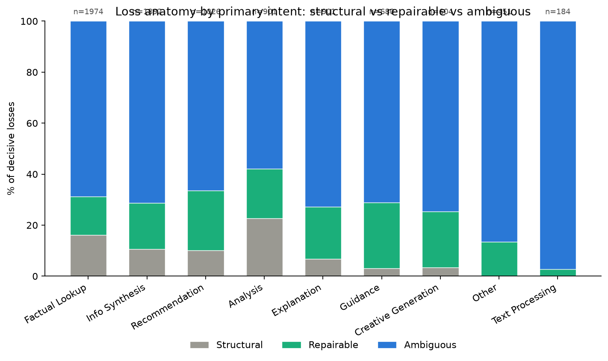

# Loss Anatomy: Structural vs Repairable Losses

## Methodology

For every decisive battle, the losing response is compared against the winning response on two axes:

1. **Is the losing model structurally weaker for this task category?** Answered by refitting the project's Bradley-Terry model (1,000 conversation-level bootstrap replications, seed `20260930`, same design matrix as the rest of this project) **separately within each `primary_intent`**, with individual base models as players. This produces a per-(model, intent) strength with a 95% CI -- see `outputs/bradley_terry_model_strength_by_intent.csv`.
2. **Was this specific response notably deficient on a tracked response-level feature?** Using the citation-count and response-length differences already computed in this pipeline.

**Feature scope, stated explicitly.** The task that produced this report asked for `has_markdown_table`, `is_refusal`, and `numbers_per_100_words` as candidate repairable-loss indicators. None of these are computed anywhere in this repo (confirmed by grep, not assumed). Per instruction not to invent new features on the spot, this report uses only `citation_diff` and `length_diff` -- the two response-level features this project already tracks. A 'repairable' loss here means specifically: *the loser cited less or wrote less, not that the model is worse at the task.* Markdown-table use, refusals, and numeric density may well be repairable levers too, but they are not measured in this dataset as it currently stands.

### Classification rule (thresholds stated plainly)

- **STRUCTURAL**: loser and winner are different base models, and the loser's 95% strength CI for this `primary_intent` sits entirely below the winner's (not merely "non-overlapping" -- specifically non-overlapping in the direction where the loser is the weaker one). The model is measurably weaker at this task category; routing around it is the fix, prompting is not. A battle where the nominally *stronger* model lost (CIs non-overlapping the other way -- an upset) is never labeled structural; it falls to repairable or ambiguous instead.
- **REPAIRABLE**: either (a) strengths are not significantly different for this intent (CIs overlap) but the loser's citation count or response length is at least **0.5 standard deviations** below the winner's (standardized against that battle's own `conversation_type` SD -- see the scaling note immediately below), or (b) both sides are literally the same base model, in which case a strength comparison is meaningless by construction and any notable citation/length deficit is the only available explanation.

**SCALING BUG FOUND AND FIXED, stated explicitly.** An earlier version of this report standardized `citation_diff`/`length_diff` for every battle against one **pooled** `sd_cit`/`sd_len` computed across all 8,613 decisive battles -- this is the "same global SD scaling used everywhere else in this project" convention, and it was the wrong call here. A direct check confirmed `multi_turn` and `single_turn` battles have meaningfully different scales:

| scaling | sd_cit | sd_len |
|---|---|---|
| pooled (previously used for every battle) | 6.126 | 3,222.7 |
| `multi_turn` only (n=1,714) | 9.498 | 5,507.1 |
| `single_turn` only (n=6,899) | 4.945 | 2,330.3 |

`multi_turn`'s own spread is roughly **1.9x** `single_turn`'s on citations and **2.4x** on length. Standardizing every battle against the pooled value (which sits between the two, weighted toward `single_turn` by its larger n) inflated how deficient `multi_turn` battles looked relative to `multi_turn`'s own variation, and shrank how deficient `single_turn` battles looked relative to `single_turn`'s own variation -- biasing the repairable/ambiguous split for **every battle in both groups**, not only the `conversation_type` breakdown table. **This report now standardizes each battle against its own `conversation_type`'s `sd_cit`/`sd_len`** (the table above), computed with the same `_scale_covariates` function, just called separately per `conversation_type` instead of once on the pooled set. The pooled `sd_cit`/`sd_len` is still used, unchanged, inside Step 1's Bradley-Terry covariate fit (`beta_citation`/`beta_length` in the per-intent strength model) -- that usage makes those coefficients comparable *across `primary_intent` categories* and is a different computation from the citation/length deficiency check this bug fix addresses.
- **AMBIGUOUS**: neither condition clearly holds, OR at least one side's per-intent strength estimate rests on fewer than **60 battles** for that model within that intent and is therefore too noisy to anchor a structural call. Ambiguous battles are not forced into either other bucket.

**Honesty check on the thresholds:** the half-SD feature threshold and the 60-battle reliability cutoff are both judgment calls, not statistically derived values -- they are stated here so they can be revisited. The CI-non-overlap rule for STRUCTURAL is the more principled of the two since it inherits directly from the bootstrap, but note that non-overlapping 95% CIs is a stricter (more conservative) test than a formal two-sample difference test; some battles labeled 'ambiguous' here might be structural under a less conservative test.

- **Data:** 8,613 decisive battles. 8,613 classified; **0** excluded because their `primary_intent` had too few total battles to fit a per-intent model at all (see `bradley_terry_by_intent.csv`'s existing `insufficient n` rows for the same cutoff).

- **Per-intent strength reliability:** 9 of 81 (model, intent) cells were fit on fewer than 60 battles for that model in that intent and are flagged `low_n=True` in the strength CSV. Battles involving at least one such cell are routed to AMBIGUOUS rather than silently classified.

## Findings: loss anatomy by primary intent

| primary_intent | n losses | structural | repairable | ambiguous | % structural | % repairable | % ambiguous |
|---|---|---|---|---|---|---|---|
| Guidance | 680 | 21 | 175 | 484 | 3.1% | **25.7%** | 71.2% |
| Recommendation | 1026 | 104 | 241 | 681 | 10.1% | **23.5%** | 66.4% |
| Creative Generation | 604 | 21 | 132 | 451 | 3.5% | **21.9%** | 74.7% |
| Explanation | 901 | 61 | 184 | 656 | 6.8% | **20.4%** | 72.8% |
| Analysis | 901 | 205 | 174 | 522 | 22.8% | **19.3%** | 57.9% |
| Info Synthesis | 1892 | 200 | 343 | 1349 | 10.6% | **18.1%** | 71.3% |
| Factual Lookup | 1974 | 320 | 297 | 1357 | 16.2% | **15.0%** | 68.7% |
| Other | 451 | 0 | 61 | 390 | 0.0% | **13.5%** | 86.5% |
| Text Processing | 184 | 0 | 5 | 179 | 0.0% | **2.7%** | 97.3% |

*Stacked bars show the share of each intent's decisive losses that are structural (gray), repairable (green), or ambiguous (blue); `n` above each bar is the total losses classified for that intent.*

## Findings: loss anatomy by cost tier (of the losing model)

| cost_tier (loser) | n losses | structural | repairable | ambiguous | % structural | % repairable | % ambiguous |
|---|---|---|---|---|---|---|---|
| cheap | 2165 | 354 | 359 | 1452 | 16.4% | **16.6%** | 67.1% |
| mid | 1042 | 70 | 360 | 612 | 6.7% | **34.5%** | 58.7% |
| expensive | 5406 | 508 | 893 | 4005 | 9.4% | **16.5%** | 74.1% |

## Findings: loss anatomy by conversation type

Added to tie this analysis to the both-bad-rate finding (`both_bad_rate_summary.md`): multi-turn conversations have a meaningfully higher both-bad rate than single-turn (14.9% vs 11.4%, CIs do not overlap). This checks whether the same multi-turn effect shows up in the structural/repairable/ambiguous split for *decisive* losses, or only in the both-bad (tie) signal.

| conversation_type | n losses | structural | repairable | ambiguous | % structural | % repairable | % ambiguous |
|---|---|---|---|---|---|---|---|
| multi_turn | 1714 | 152 | 289 | 1273 | 8.9% | **16.9%** | 74.3% |
| single_turn | 6899 | 780 | 1323 | 4796 | 11.3% | **19.2%** | 69.5% |

## Plain-language summary

**Most repairable room:** `Guidance` has the highest repairable-loss share (25.7% of its 680 losses) -- in this category, losing models are frequently not weaker overall, they simply cited or wrote less in the specific battle they lost. This is where better prompting (asking for more citations, longer/more complete answers) has the most headroom to change outcomes.

**Most structural:** `Analysis` has the highest structural-loss share (22.8%) -- losses here are driven by a measurable overall strength gap for that task category, not a fixable response feature. Routing to a stronger model for this intent is the available lever, not prompting.

**The repairable bucket is not all the same claim.** Of the 1,612 battles labeled repairable, **76 (4.7%)** are a model playing itself (same base model on both sides) -- these describe generation variance between two draws of one model, not a case where a different or cheaper model would have closed the gap. The remaining **1,536 (95.3%)** are genuine cross-model comparisons, where a different model under-cited or under-wrote relative to the one that beat it. See caveat #8 below for the per-intent/per-tier breakdown.

**Does multi-turn's higher both-bad rate carry over to decisive losses?** Multi-turn: 1,714 losses (8.9% structural / 16.9% repairable / 74.3% ambiguous). Single-turn: 6,899 losses (11.3% / 19.2% / 69.5%). In short: multi-turn losses skew **more ambiguous** than single-turn (74.3% vs 69.5%) -- so part of multi-turn's higher both-bad rate does appear to carry over into how its decisive losses break down, not just into more ties.

## Caveats

1. **Feature scope is narrow.** Only citation count and response length are available as response-level features (see Methodology above); markdown tables, refusals, and numeric density are not measured in this repo.
2. **Thresholds are judgment calls**, stated explicitly above, not derived statistically.
3. **9 of 81** per-(model, intent) strength cells rest on thin data and are excluded from driving a structural call (routed to ambiguous instead).
4. **0 battles excluded** entirely because their intent had too few total battles to fit at all (same `MIN_N_FOR_FIT` cutoff used elsewhere in this project).
5. **Non-overlapping 95% CIs is a conservative structural test.** Some battles labeled ambiguous might be structural under a less conservative two-sample test; this report errs toward under-calling structural rather than over-calling it.
6. **Citation/length are observational, not causal**, same caveat as the rest of this project's citation-effect findings: a model that cites more or writes more differs from one that doesn't in other ways not measured here.
7. **The per-intent strength is fit on the same battles it's used to classify.** It is not a held-out / leave-one-out estimate -- the strength for `model X` in intent `Y` is fit using all of `model X`'s battles in intent `Y`, including the very battle being classified. At the sample sizes here (hundreds to ~2,000 battles per intent) any single battle's influence on its own model's strength estimate is small, but this is not a fully independent test and should be described that way if asked, not as a clean train/test split.
8. **674 of 8,613 decisive battles (7.8%) are a model playing itself** (`base_model_a == base_model_b`) -- the same model generating two independent responses. These can never be classified structural by construction (a model cannot be structurally weaker than itself), so every one of them falls into repairable or ambiguous. **76 of the 1,612 repairable-labeled battles (4.7%) are this same-model flavor** -- meaning they describe generation variance between two draws of one model, not "a different/cheaper model could close this gap with better prompting." The remaining 1,536 (95.3%) repairable battles are genuine cross-model comparisons and are the ones the routing/prompting recommendation above actually applies to.

